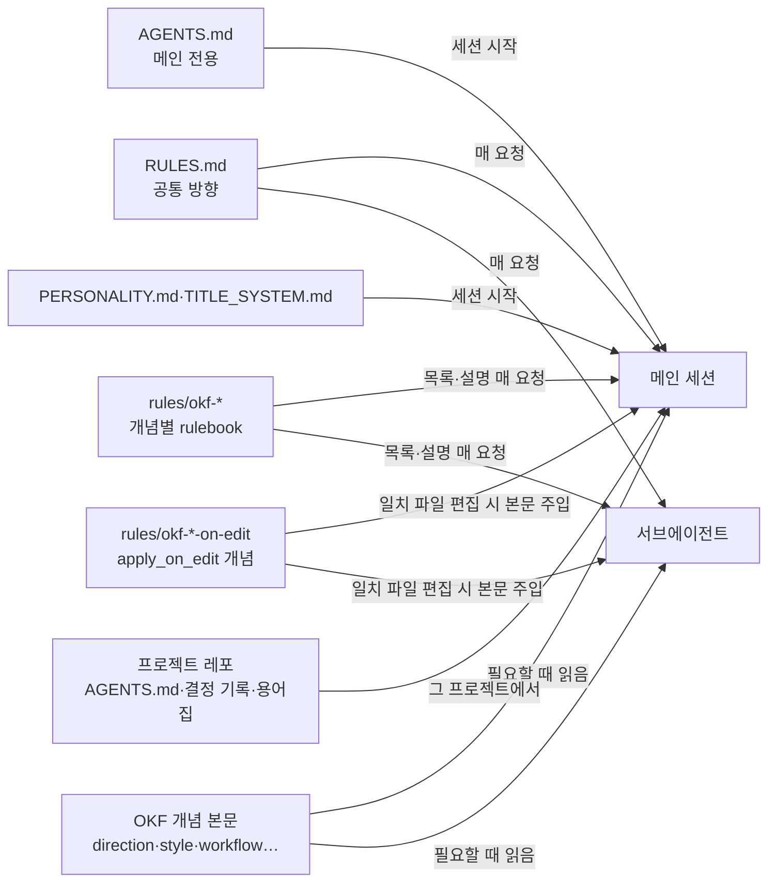

# omp 다중 PC 자동 설정

다른 로컬 PC(macOS/Linux/Windows)에 같은 omp 환경을 재현하는 부트스트랩이다. 설정의 목적은 에이전트가 사용자와 같은 지식을 갖게 하는 것이 아니라, **모델의 기본 선택을 사용자의 방향으로 바꾸고 모델에 부족한 지식을 채우는 것**이다. 모델이 이미 정확히 아는 일반 지식과 일회성 작업 기록은 쌓지 않는다.

## 구성

```
hello-omp/
  setup.sh / setup.ps1     OS별 부트스트랩 (사전 점검 후 8단계 배포)
  config/settings.conf     OMP 설정 키의 단일 소스: 역할별 모델·fallback·advisor·표시·도구 승인·격리·이미지 생성
  rules/RULES.md           모든 에이전트(서브에이전트 포함)에 매 요청 적용되는 공통 방향 (sticky rule)
  rules/AGENTS.md          메인 세션 전용 규칙: 소통·질문·검증·독립 검토·지식 기록
  rules/WATCHDOG.md        advisor 전용 지침 (한국어 노트, 근거 없는 빈 노트 금지, 처리량·위험 실행·중단 지시 감시)
  rules/PERSONALITY.md     메인 세션의 기본 personality 블록을 대신하는 한국어 문체·처리량 기준
  rules/TITLE_SYSTEM.md    세션 제목을 한국어로 짓는 제목 생성 프롬프트
  ttsr/                    TTSR 알림 규칙 → <configdir>/rules/ (현재 없음, 배포·정리 경로만 유지)
  okf/                     OKF 지식 번들 소스 (필요할 때 읽는 방향·규칙·비자명 사실)
  commands/                슬래시 명령 /interview, /arch-review, /project-map, /cleanup
  skills/                  archify, goldfish-review, knowledge-sync, project-map
  extensions/              런타임 확장 (dangerous-tool-guard)
  scripts/                 validate-okf, deploy-okf, deploy-skills, sync-managed
  AGENTS.md                이 레포에만 적용하는 프로젝트 지침
  agents/                  사용자 정의 에이전트 design-reviewer (그 밖은 빌트인 + 역할별 모델)
```

## 지식이 에이전트에 닿는 경로



| 층 | 내용 | 크기 원칙 |
|---|---|---|
| `RULES.md` | 코드 표기(PascalCase·줄·빈 줄), 구현 선택 순서, 멀티스레드 관점, 작업 기본값(TS+Bun·작업 파일 위치·증거·실행 경계), OKF 진입점 | 짧게. 매 요청 비용 |
| `AGENTS.md` | 한국어 존댓말·보고 형식, 질문과 요구 정렬, 정확성·보안 경고, 위험에 비례한 독립 검토, 프로젝트 지도 트리거, 지식 기록 기준 | 메인 세션에만 로드 |
| `PERSONALITY.md` | omp 기본 personality(영어 단문·조각 문체)를 대신하는 한국어 완결 문장·결론 우선·처리량 기준 | 메인 세션에만. 서브에이전트는 personality가 없어 `RULES.md`의 「언어」를 따른다 |
| `TITLE_SYSTEM.md` | 세션 제목을 한국어로 짓게 한다(`title.generator=tiny`의 제목 모델에 적용) | 제목 생성 호출에만 |
| `okf/` | [사용자 개발 방향](okf/direction.md), 코딩 스타일, 워크플로, 도메인별 비자명 사실 | 작업에 맞는 개념의 본문을 읽음 |
| `<configdir>/rules/okf-*` | setup·`--record`가 개념마다 생성하는 rulebook 규칙(이름·설명이 매 요청 시스템 프롬프트에 나열, 본문은 `rule://`)과, `apply_on_edit`가 있는 개념의 편집 시 자동 주입 규칙 | 품질 우선: 개념 목록을 매 요청 보인다 |
| `ttsr/` → `<configdir>/rules/` | 메인 세션 전용 TTSR 알림의 배포 경로. 현재 규칙은 없다. 예전 `design-review-reminder`는 첫 편집마다 출력을 끊고 설계 검토를 다시 묻게 해 과잉 절차를 부추겨 지웠고, setup의 관리 항목 정리가 배포본을 옮겨 둔다 | 규칙이 생기면 세션당 1회 |
| 프로젝트 레포 | 그 프로젝트의 현행 지침(`AGENTS.md`)·결정 기록·용어집 | 작업 이력·검증 기록은 쓰지 않음 |

OMP 18.12.1에서 task 서브에이전트는 `AGENTS.md`를 상속하지 않고 rule(`RULES.md`·`rules/*` 포함)은 받는다(`omp://system-prompt-customization.md`, `omp://rulebook-matching-pipeline.md`). 그래서 서브에이전트에도 필요한 방향은 `RULES.md`에 두고, OKF 개념은 `okf-*` 규칙으로 서브에이전트에도 보인다.

기록 기준은 [OKF 학습 축적](okf/learning/accumulation.md)이 정본이다. 후보마다 "이 문장이 없으면 모델이 다르게 행동하는가 / 다시 쓰이는가 / 기존 원리로 설명되지 않는가"를 묻고 셋 다 통과한 사용자 방향과 비자명 사실만 기록한다. 실수는 사건이 아니라 위반한 원리로 기록한다. 개념의 frontmatter `description`이 `index.md` 항목 설명의 정본이며, 고친 뒤 `bun scripts/validate-okf.ts --fix okf`가 항목 문구를 맞춘다.

## 사용

전제: **OMP 18.8.0 이상**, **Bun 1.2.21 이상**(`validate-okf.ts`가 `Bun.YAML` 사용)이 PATH에 있어야 한다. setup은 자동 업그레이드하지 않는다. 교차 provider fallback을 쓰려면 두 provider의 유효 인증이 필요하다([구독과 인증의 경계](okf/agents/guide.md#구독과-인증의-경계)).

```sh
# macOS / Linux
sh setup.sh
```

```powershell
# Windows
.\setup.ps1
```

배포한 지침은 **새 세션**부터 적용된다. 이미 열린 세션은 이전 지침을 계속 쓰므로 `omp`를 다시 시작한다.

역할별 모델·추론 강도·fallback은 `config/settings.conf`가 정본이다. 메인·계획·구현·정밀 검토는 `xhigh`, 디자인·화면 분석·advisor는 `high`, 탐색·커밋은 `medium`, 제목·메모리는 `low`이며 각 chat 역할에 다른 provider의 fallback을 하나 둔다. 배정 이유는 [에이전트 가이드](okf/agents/guide.md#현재-배정의-이유)를 본다. 적용값은 `omp config list`로 확인한다. 현재 대화의 모델만 바꿀 때는 `/switch <provider/model:effort>`를 쓴다(`/model`은 선택기라 인자를 받지 않는다).

비동기 advisor는 작업 중 위험·과잉 절차 감시용으로 켜 둔다(`advisor.enabled=true`). 독립 검토를 대신하지 않는다([워크플로](okf/workflow.md#독립-검토-시점과-최종-응답)).

이미지 생성 도구는 켜 두고(`generate_image.enabled=true`) `image` 역할을 구독 경로의 `openai-codex/gpt-image-2`로 고정하며 fallback을 두지 않는다. API 과금 경로로 자동 전환되지 않게 하려는 것으로, 이유와 한계는 [에이전트 가이드](okf/agents/guide.md#현재-배정의-이유)를 본다.

## 명령과 스킬

| 입력 | 하는 일 |
|---|---|
| `/interview [대상]` | 기능·설계를 결정 트리로 끝까지 정렬한다. 질문마다 추천 답을 붙이고, 확정된 용어·결정은 프로젝트 문서에 남긴다. 이해가 맞았다고 확인하기 전에는 구현하지 않는다. |
| `/arch-review [범위]` | 다음 변경을 어렵게 만드는 구조 마찰(얕은 모듈·소유 경계 누수·테스트하기 어려운 곳)을 찾아 후보만 보고한다. 코드는 사용자가 고른 후보만 이후에 고친다. |
| `/project-map`, `/project-map status` | 프로젝트 책임·상태·할 일 지도를 만들거나 갱신한다. `status`는 읽기 전용. 기준은 [프로젝트 지도와 작업 동기화](okf/project-navigation.md)와 [화면 설계](okf/project-map-design.md). |
| `/cleanup`, `/cleanup preview`, `/cleanup all` | 작업 산출물을 목록·승인 기반으로 정리한다. `all`은 탐색 확대일 뿐 전체 삭제 승인이 아니다. 정본은 [`commands/cleanup.md`](commands/cleanup.md). |
| `/skill:knowledge-sync` | 원격에 푸시된 지식·설정을 로컬 작업과 로컬 지식을 지키며 병합하고 setup을 실행한다. push·rebase는 하지 않는다. |
| `/skill:archify …` | 아키텍처·흐름을 인터랙티브 HTML 다이어그램으로 만든다. 일반 작업에서 HTML을 자동 생성하지 않는다. |
| (자동) `goldfish-review` | 설계 선택이 결과를 좌우하는 작업([워크플로](okf/workflow.md#독립-검토-시점과-최종-응답): 여러 모듈 새 기능 통합, 버전 이식, 되돌리기 비싼 미결 대안)이면 에이전트가 지시 없이 사용한다. 짧은 설계 문서를 대화 맥락이 없는 `design-reviewer`가 검토하며 기본은 한 단계, 재검토는 1회까지다. 한 가지 목적의 스크립트·한 지점 수정에는 쓰지 않는다. 직접 부를 때는 `/skill:goldfish-review`(사용자가 요청하면 전체 경로). 출처는 [Elephant-Goldfish Model](skills/goldfish-review/UPSTREAM.md). |

명령 파일은 세션 시작과 cwd 변경 때 발견된다. 실행 중인 세션에서는 `/reload-plugins`로 갱신한다. 작업 디렉터리의 `.omp/commands/`에 같은 이름이 있으면 그쪽이 우선한다.

## 배포 순서 (setup이 수행)

사전 점검(하나라도 걸리면 설정을 바꾸기 전에 중단): `omp`·`bun` PATH, `title.generator` 지원, `<configdir>`가 레포 루트와 다른지, `deploy-skills.ts --check`(OKF·스킬 경로 겹침), `deploy-okf.ts --check`(로컬 지식 검증·이전 setup의 삭제 감지·레거시 이관 충돌·생성할 `okf-*` 규칙 이름이 개념끼리 겹치거나 `okf_source` 없는 사용자 규칙(`.md`·`.mdc`)과 겹치는지·`rules` 디렉터리나 `okf-*` 규칙이 링크인지).

1. **설정:** `config/settings.conf`의 키를 `omp config set`으로 적용한다.
2. **글로벌 룰:** `rules/AGENTS.md`·`rules/RULES.md`·`rules/WATCHDOG.md`·`rules/PERSONALITY.md`·`rules/TITLE_SYSTEM.md` → `<configdir>/`(각 기존 파일은 최초 1회 `.bak`). `AGENTS.md`·`RULES.md`의 자리표시자 `__OKF_DIR__`(배포본)·`__OKF_SOURCE_DIR__`(소스)를 절대경로로 바꾼다. 다른 자리표시자는 없으므로 레포 루트가 필요하면 `__OKF_SOURCE_DIR__/..`로 쓴다. `TITLE_SYSTEM.md`는 OMP가 일반 config base(기본 `~/.omp/agent`)에서 찾고 `PI_CODING_AGENT_DIR`은 그 위치를 바꾸지 않으므로, 이 변수로 격리 배포하면 제목 프롬프트는 적용되지 않으며 setup이 경고한다(`omp://config-usage.md`). `ttsr/*.md` → `<configdir>/rules/`(같은 이름 덮어씀, `okf-*` 생성 규칙과 다른 이름).
3. **OKF:** `validate-okf.ts`로 소스를 검사한 뒤(concept frontmatter, `index.md`의 섹션 제목과 항목 title·description 일치, 루트 index에서의 도달성, `log.md` 날짜 제목 형식·최신순) `deploy-okf.ts`가 공개 번들을 `<configdir>/okf/`에 제자리 갱신한다. 레포에서 사라진 공개 파일은 지우고 `<configdir>/okf/learned/`의 로컬 concept은 건드리지 않는다. `learned/index.md`만 레포 틀과 로컬 concept의 frontmatter로 다시 만든다. 이어서 배포본의 모든 개념을 `<configdir>/rules/okf-*.md` 규칙으로 생성하고 사라진 개념의 규칙은 지운다. `okf_source`가 없는 사용자 규칙은 건드리지 않으며, 같은 이름이면 중단한다.
4. **확장:** `extensions/*.{js,ts}` → `<configdir>/extensions/`.
5. **에이전트(있을 때만):** `agents/*.md` → `<configdir>/agents/`.
6. **명령:** `commands/*.md` → `<configdir>/commands/`. 다른 사용자 명령은 보존한다. 명령·스킬은 자리표시자를 치환하지 않으므로 OKF가 필요하면 전역 지침의 OKF 절대경로를 가리킨다.
7. **스킬:** `skills/<name>/` → `<configdir>/skills/<name>/`. 동일본은 생략하고, 다른 기존본은 `<configdir>/.skill-backup-<고유값>/`에 보존한 뒤 교체한다.
8. **관리 항목 동기화:** `sync-managed.ts`가 배포 기록 `<configdir>/.hello-omp-managed.json`을 갱신한다. 레포에서 사라진 설정 키는 setup이 적용한 값 그대로일 때만 `omp config reset`하고, 사라진 확장·에이전트·명령·TTSR 규칙·스킬은 바뀌지 않았을 때만 `<configdir>/.managed-retired-<stamp>/`로 옮긴다. 모든 키가 `omp config list --json`과 일치하는지 검증한다.

`<configdir>`는 `omp config path`로 해석한다(기본 `~/.omp/agent`, `PI_CODING_AGENT_DIR`로 재지정, 이름 있는 프로필은 `~/.omp/profiles/<name>/agent`이고 `PI_CODING_AGENT_DIR`을 무시). setup이 만든 `.bak`·`.skill-backup-*`·`.managed-retired-*`·`.okf-local/`은 자동 삭제하지 않는다.

### 공개 지식과 로컬 지식

- **공개 지식:** 이 레포의 `okf/`에서 고치고 setup으로 배포한다. 배포본만 고치면 다음 setup에서 되돌아간다.
- **로컬 지식:** 공개하기 어려운 개인 선호와 검토 중인 지식만 `<configdir>/okf/learned/`에 직접 둔다(이 PC 전용, 동기화 안 됨). 레포 `okf/learned/`에 두지 않는다. `git merge`·`git pull`은 기본값 `--overwrite-ignore`로 같은 경로의 무시된 파일을 덮어쓰기 때문이다. 만들거나 고치거나 지운 뒤에는 `bun scripts/deploy-okf.ts --record <configdir>`로 검사하고 `learned/index.md` 목록을 다시 만든다.
- **삭제 감지와 복원:** 커밋 `92b4987` 이전 setup은 `<configdir>/okf`를 지운 뒤 복사했다. 새 setup은 배포 마커와 `.okf-local/` 이력으로 그런 삭제를 감지하면 중단하며, `bun scripts/deploy-okf.ts --restore <configdir>`로 복원한 뒤 다시 실행한다. `--record` 뒤의 의도적 삭제는 되살리지 않는다.
- **프로젝트 지식:** 프로젝트 한정 결정·용어는 그 프로젝트 레포의 문서에 둔다.

## 안전한 테스트 (실제 설정 미변경)

`OMP_PROFILE=default`와 `PI_CODING_AGENT_DIR`을 이 레포의 `.omp-artifacts/<작업-ID>/config`로 지정해 격리 배포한다. 이름 있는 프로필은 `PI_CODING_AGENT_DIR`을 무시하므로 `omp config path`가 격리 경로인지 먼저 확인하고 다르면 중단한다. 검증 배포본은 자동 삭제하지 않는다. 메인 clone에서 실행하면 clone의 `okf/learned/`에 남은 레거시 파일이 격리 설정 폴더로 복사될 수 있다(실제 설정 폴더는 바뀌지 않음). 격리 경로에 복사한 custom agent는 OMP의 agent 탐색 경로가 달라 발견·실행 검증이 되지 않는다.

```sh
# macOS / Linux
(
  export OMP_PROFILE=default
  export PI_CODING_AGENT_DIR="$PWD/.omp-artifacts/<작업-ID>/config"
  mkdir -p "$PI_CODING_AGENT_DIR"
  [ "$(CDPATH= cd "$(omp config path)" && pwd -P)" = "$(CDPATH= cd "$PI_CODING_AGENT_DIR" && pwd -P)" ] || exit 1
  sh setup.sh
)
```

```powershell
# Windows
$oldProfile = $env:OMP_PROFILE
$oldAgentDir = $env:PI_CODING_AGENT_DIR
try {
  $env:OMP_PROFILE = 'default'
  $env:PI_CODING_AGENT_DIR = Join-Path $PWD '.omp-artifacts/<작업-ID>/config'
  if ([IO.Path]::GetFullPath((omp config path).Trim()).TrimEnd([char[]]'\/') -ne [IO.Path]::GetFullPath($env:PI_CODING_AGENT_DIR).TrimEnd([char[]]'\/')) { throw 'unexpected config path' }
  .\setup.ps1
} finally {
  $env:OMP_PROFILE = $oldProfile
  $env:PI_CODING_AGENT_DIR = $oldAgentDir
}
```
